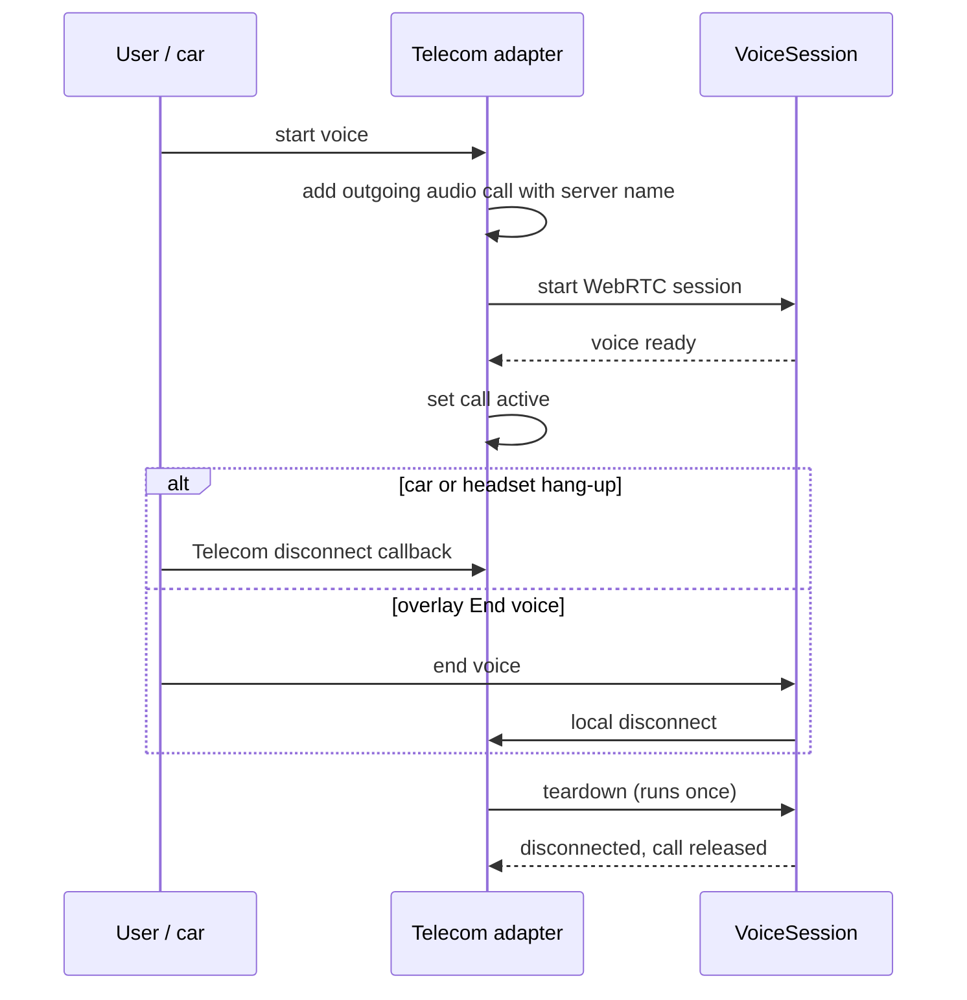

# Car HFP Call Control

Go Mode voice sessions register with Android Telecom as self-managed audio
calls. A car or headset hang-up then requests a Telecom disconnect. Go Mode does
not infer hang-up from Bluetooth SCO teardown. Phases:
[PLAN_GOMODE.md](PLAN_GOMODE.md).

## Decision

Use AndroidX Core-Telecom (`androidx.core:core-telecom`) for every active voice
session. It wraps the legacy `ConnectionService` path and the newer
transactional APIs, and supports `minSdk = 33`. Go Mode keeps its voice overlay
and does not become the default dialer. Android provides Bluetooth HFP,
automotive, audio-route, and call-concurrency integration.

`MediaSession` and SCO broadcasts are not the hang-up mechanism. They report
media buttons and audio routing, not HFP call control.

## Car Caller ID

Android's outgoing HFP call list sends a sanitized number without the Telecom
display name. Saved servers therefore use a stable numeric caller identifier.
In native settings, **Create contacts** opens Android's import flow for the
**Go Mode** shortcut and every saved server with an assigned number. Enable
contact sharing for the car in Bluetooth settings after importing.

The stable **Go Mode** shortcut is `+1-867-555-0100`. At dialing time it resolves the
persisted active saved server, independently of background page loading. It does
not change the server-specific number shown during the resulting voice call.
If no unique active saved server or local settings are available, its dial is
canceled without placing a cellular call.

Server contacts use `+1-867-555-0101` through `+1-867-555-0199`, within
[NANPA's fictitious, non-working range](https://nanpa.com/numbering/555-line-numbers).
Assignments are persisted before the app loads saved services, and survive
renaming, URL changes, reordering, and app restarts. Retired assignments are not
recycled: a saved contact must never silently start another server. If all 99
server slots are allocated, additional servers use the generic caller identity
and can still be started through the Go Mode shortcut. Assignments are local to
the app's saved settings; recreate contacts after clearing app data or setting
up another phone.

The server-specific contact name comes from the saved server label. Edit that
contact if you rename the server. Its identifier stays the same when its label or URL changes;
deleting and re-adding the server creates a new identity. The identifier cannot
receive ordinary phone calls. With dial-to-start enabled, dialing it locally
starts the saved server's Go Mode voice session.

[CarCallerID.kt](../android/gomode/src/main/java/com/fghbuild/gomode/voice/CarCallerID.kt)
owns the contact and call-address mapping. Android's Contacts app owns the
import operation; Go Mode does not read contacts or track whether a contact was
saved. Standalone voice without a saved server has no contact mapping.

## Dial-to-Start Contract

In native settings, save a server, sign in, and test its voice configuration.
Under **Dial from your car**, allow microphone access, choose **Enable
dial-to-start**, then select Go Mode in Android's call-redirection chooser.
The setting reports Android's current role ownership; declining the chooser
leaves dial-to-start off. **Disable dial-to-start** disables the redirection
component and cancels pending Go Mode launches. Losing the Android role or
microphone permission also cancels pending startup. Normal in-app voice does
not require call redirection. The setting does not verify host sign-in or
availability; test the saved voice mode before leaving the phone locked.

After this one-time setup, dialing a saved server's identifier starts that server;
dialing the Go Mode identifier starts the last selected saved server. Both start
a native voice session without touching the phone, including after normal app
process death with the phone locked. The phone must have been unlocked once after boot, and
microphone permission and host sign-in must already be available. Keypad dialing
needs no contact; a named shortcut needs a saved contact shared with the car.

The entry point is Android's user-selected
[call-redirection role](https://developer.android.com/reference/android/app/role/RoleManager#ROLE_CALL_REDIRECTION).
For an exact server or Go Mode identifier match, launch the ordinary Go Mode Activity
while Telecom's binding permits a background Activity, cancel the cellular attempt, and register
a fresh Go Mode self-managed call before network or model setup. This is a local
launch trigger. The
[redirection API](https://developer.android.com/reference/android/telecom/CallRedirectionService)
limits `redirectCall()` targets to SIM accounts; it does not directly transfer
the cellular call into the existing Core-Telecom session. Its callback requires
a response within five seconds, so host discovery, authentication, model loading,
and network requests cannot delay that response.

Ordinary and unrecognized numbers retain their original number and phone
account. Emergency routing stays with Android. Unavailable local settings must
not hold up ordinary dialing. Never intercept an entire number prefix. Preserve
the existing identifier mapping and resolve it to one current saved server.
Exact matching applies to the network number Android supplies to the service;
Telecom removes post-dial digits before invoking it, so the original keypad
string is unavailable. Go Mode removes only presentation separators from that
network number and does not match extra digits or extensions it receives.
Recognized requests that fail later stay canceled and cannot fall back to a
cellular attempt. Go Mode's own calls must not launch another session.

Launch requests need bounded lifetimes and a single lifecycle owner, so duplicate
delivery, teardown, role loss, and process replacement cannot start stale voice.
Missing prerequisites require explicit recovery after unlocking rather than a
delayed automatic microphone start. Arbitrary external Activity intents must not
gain the authority to start microphone capture or select a server.

Android's [background microphone restrictions](https://developer.android.com/develop/background-work/services/fgs/restrictions-bg-start)
require eligible foreground ownership. MainActivity launched while
Telecom's redirection binding is active can show native call controls over secure keyguard
and start a microphone foreground service. Emulator coverage exercises text voice
and real cloud Opus/RTCP media on this entry path. Hosted content stays behind keyguard by default.
When unlocked, car-initiated calls show the ordinary Go Mode shell during setup, with its voice
panel controlling the existing call. Unlocking during a call reveals that same
shell in MainActivity without reconnecting voice; relocking protects hosted content again.
The **Show service on lock screen** setting opts into the ordinary, interactive service UI
above keyguard during car calls. It is off by default. Anyone can view and use services
without unlocking while it is enabled and a car call is active. Ending the call removes
that window grant. Native permissions, media capture, file pickers, and external sign-in
still require unlocking.

Immediate handover accepts an early-hangup race. `CallRedirectionService` provides neither
an original-call identifier nor a user-disconnect callback. Android can destroy
the managed call while redirection is pending, then allow the service's later
Activity launch to start a microphone foreground service. `isInManagedCall()`
cannot safely authorize the launch: it requires `READ_PHONE_STATE` and reports
any managed call, including an unrelated concurrent or replacement call.

The disabled debug-only
[launch probe](../android/gomode/src/debug/java/com/fghbuild/gomode/voice/CarDialLaunchProbeService.kt)
and independent [system tests](../android/car-dial-fixture/src/androidTest/java/com/fghbuild/gomode/cardialfixture/CarDialInterceptionTest.kt)
preserve both locked-screen eligibility and the pending-hangup reproduction. The
probe deliberately pauses local processing within the redirection deadline to
make the race reproducible; it does not record audio or run a voice session.
The production launch path minimizes this window, documents the race beside
the launch code, and registers the replacement Go Mode call before network or
model setup. Hanging up the original pending dial may still be followed by Go
Mode startup; this behavior is accepted. Once the replacement call exists, its
Telecom disconnect ends startup and prevents stale microphone/session work.
Faster local processing reduces the window but cannot eliminate it.

The application retains one authenticated WebView per saved service. Car calls
load their resolved service after replacement Telecom and microphone ownership
are established, including while locked. Unless lock-screen service access is enabled, hosted pixels remain behind keyguard;
the native call surface shows call status, the live transcript, audio routes, and hang-up. Unlock attaches the
same page to the ordinary shell, preserving browser tool mutations and the call.

Car and manual conversations use the same service catalog for MCP and registered
browser tools. Initial page authentication and backend access validation precede
voice setup. Account changes revoke the conversation; document replacement
invalidates old frontend dispatch/results until the page registers again. Hidden
pages cannot launch native permission prompts, file pickers, dialogs, external
windows or WebAuthn, and their media remains muted.

## Status

`TelecomCallController` implements this design. It registers the app during
setup, adds an outgoing audio call for each voice session, activates it when the
transport is ready, and ends it on a Telecom or overlay hang-up. Both voice
modes use it through `VoiceCallController`. The foreground service posts a
`Notification.CallStyle`. SCO teardown ends voice only when Telecom does not own
the call. The endpoint picker still uses `AudioManager`; phase telecom-routing
replaces it.

## Call Lifecycle

One teardown owner serves the overlay and Telecom, so duplicate or late
callbacks are harmless. A user hang-up is a local disconnect. A WebRTC or server
failure is a remote or error disconnect.

## Telecom Adapter

The adapter owns `CallsManager`, registration, one active `CallControlScope`,
and the mapping from Telecom callbacks to the voice lifecycle.

- Register capabilities during app setup, never during a call.
- Declare `MANAGE_OWN_CALLS`.
- Add an outgoing audio-only call with non-sensitive display metadata and an
  app-owned URI scheme.
- Expose four operations to `VoiceSession`: start the call, set it active, end
  it locally, and react to a Telecom disconnect.
- Show a rejected or unavailable Telecom call as a voice setup error.

## VoiceSession

`VoiceSession` keeps the WebRTC gateway, transcript, and MCP tools. Once
Telecom owns the call, SCO loss is not a hang-up.

- Start the Telecom call before or with WebRTC setup.
- Set the call active after the voice data channel is ready.
- On a Telecom disconnect, run the teardown and report completion.
- On an overlay disconnect, request a local Telecom disconnect.
- Treat WebRTC errors as call failure. Recovery runs only while the call is
  active.

## Audio Routing

Telecom owns communication routing and concurrency for an active call. The
endpoint picker uses Core-Telecom endpoints instead of
`AudioManager.setCommunicationDevice()`. The current `AudioDeviceCallback` and
SCO receiver in `VoiceSession.kt` stay only as diagnostics and as the fallback
for devices without `PackageManager.FEATURE_TELECOM`. They never end a
Telecom-managed call, and the fallback does not promise car hang-up.

There is no hold. When Telecom yields to a cellular or VoIP call, Go Mode voice
disconnects.

## Verification

Unit tests use a fake adapter at the Telecom boundary and cover: setup success,
Telecom rejection, car disconnect, overlay disconnect, WebRTC failure, and
duplicate disconnect callbacks. Do not simulate a car with Bluetooth broadcasts.

HFP implementations vary, and an emulator cannot validate them. On a Bluetooth
headset and the target car head unit:

1. Start voice. The device shows a Go Mode call.
2. Press hang-up. WebRTC, microphone, foreground call state, and overlay end.
3. End voice from the overlay. The remote call UI clears.
4. Switch between car Bluetooth, speaker, and wired or USB endpoints during
   voice.
5. Receive or place a cellular call during voice. Voice disconnects.

Capture `GoModeVoiceSession`, Telecom, and Bluetooth logs for failures.

## References

- [Core-Telecom guide](https://developer.android.com/develop/connectivity/telecom/voip-app/telecom)
- [CallsManager](https://developer.android.com/reference/androidx/core/telecom/CallsManager)
- [ConnectionService](https://developer.android.com/reference/android/telecom/ConnectionService)
- [Audio Manager self-managed call guide](https://developer.android.com/develop/connectivity/bluetooth/ble-audio/audio-manager)
