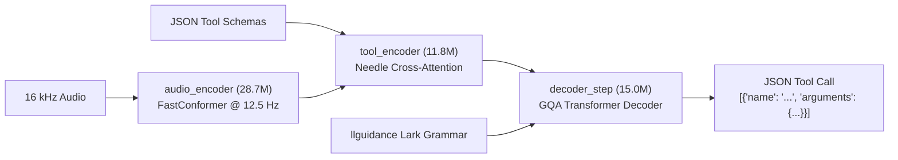
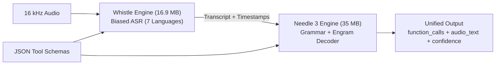
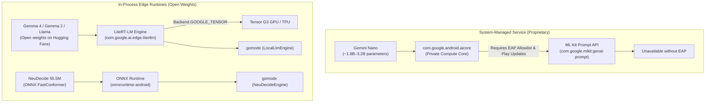

# On-Device Voice and Action Models

Investigation of 100% on-device language models, direct speech-to-action models, and mobile execution feasibility on the Google Pixel 8 Pro.

## Sub-300M Parameter Language Models

The [MaruthLabs mobile benchmark](https://www.maruthlabs.com/madhuram-in-your-pocket.html) measured four compact language models on a Nothing Phone (3a) (Snapdragon 7s Gen 3, 4 threads, 4-bit quantization, `llama.cpp`):

| Model | Parameters | On-disk size (`q4`) | Decode throughput | Prefill throughput (2048 tokens) |
| :--- | :--- | :--- | :--- | :--- |
| **Madhuram-v0.6** | 151M | 100 MB | 119 tok/s | 452 tok/s |
| **SmolLM2** | 135M | 104 MB | 117 tok/s | 230 tok/s |
| **LFM2.5** | 230M | 151 MB | 86 tok/s | 645 tok/s |
| **Gemma-3** | 270M | 247 MB | 54 tok/s | 293 tok/s |

Sub-300M models fit inside phone memory and CPU caches. They generate tokens at speeds above human reading rates without neural accelerators.

### Architecture Characteristics

*   **Madhuram-v0.6:** Uses the Perseus architecture. Combines a 16,384-token context window, grouped-query attention, QK normalization, and custom positional embeddings. Matches commonsense reasoning of comparable models (~47.5% average on ARC-E, PIQA, WinoGrande, and HellaSwag).
*   **LFM2.5-230M:** Liquid Foundation Model hybrid architecture. Delivers higher prefill throughput on long prompts (645 tok/s).
*   **SmolLM2-135M:** Standard transformer architecture trained on educational web and synthetic tokens. Reaches 117 tok/s decode.

---

## Google Pixel 8 Pro Feasibility

The Pixel 8 Pro operates with the Google Tensor G3 SoC:

*   **CPU:** 9 ARMv9 cores (1x Cortex-X3 at 3.00 GHz, 4x Cortex-A715 at 2.45 GHz, 4x Cortex-A510 at 2.15 GHz).
*   **Memory:** 12 GB LPDDR5X RAM with ~34 GB/s peak bandwidth.
*   **GPU:** Arm Mali-G715 MP10.
*   **NPU / TPU:** Google Tensor G3 TPU.

### Execution Profiles

#### Profile A: Sub-300M Models via `llama.cpp` CPU

Memory bandwidth governs autoregressive decode speed:

$$\text{Theoretical Maximum Decode} = \frac{\text{Memory Bandwidth}}{\text{Model Weight Size}}$$

For a 150M model in 4-bit quantization (~75 MB weight read per token), the ~34 GB/s memory bus yields an upper ceiling over 400 tok/s.

*   *Hypothesis:* The Pixel 8 Pro's Cortex-X3 and Cortex-A715 cores will produce **120 to 150+ tokens per second** decode for Madhuram-151M or SmolLM2-135M across 4 threads.
*   *Thermal behavior:* A 100 MB working set remains within CPU cache hierarchies. Power consumption remains low, preventing thermal throttling.
*   *Capabilities:* Sub-300M models succeed at intent extraction, structured JSON generation, and single-turn tool selection. They fail at deep factual recall and multi-step reasoning.

#### Profile B: 1B to 3B Models via `llama.cpp` CPU

*   *Measured baseline:* Community benchmarks of `llama.cpp` CPU execution on Tensor G3 report **5 to 6 tokens per second** for 1B to 2.6B models (Gemma-2-2B, Phi-2) at `Q4_0`.
*   *GPU limits:* Mali-G715 OpenCL and Vulkan backends suffer from driver overhead and poor GEMV kernel scheduling, reducing generation speed to 1 to 2 tok/s.

#### Profile C: System Gemini Nano via Android AICore

*   *Model:* Gemini Nano (~1.8B to 3.2B parameters, 4-bit quantized).
*   *Accelerator:* Tensor G3 TPU.
*   *Throughput:* ~15 to 20 tokens per second.
*   *System integration:* Zero APK download overhead; managed by the OS.
*   *Limitation:* Fixed API surface (summarization, rewrite, smart reply). Does not allow custom GGUF weights or arbitrary grammar-enforced tool schemas.

---

## NeuDecide: Direct Speech-to-Action

[NeuDecide](https://github.com/neuphonic/neudecide) (Neuphonic, Apache 2.0) maps raw audio directly into tool calls. It executes without an intermediate speech-to-text transcript.



### Technical Specifications

The system contains 55.5M parameters across three ONNX graphs:

| Graph | Parameters | Size (`q4`) | Function |
| :--- | :--- | :--- | :--- |
| `audio_encoder` | 28.7M | 22.5 MB | Waveform $\to$ 12.5 Hz latent frames |
| `tool_encoder` | 11.8M | 10.1 MB | Audio frames + JSON tool tokens $\to$ cross-attention keys and values |
| `decoder_step` | 15.0M | 10.0 MB | Autoregressive token generation with cached self-attention KV |

*   **Total size:** 42.7 MB on disk (`q4` int4 MatMulNBits export).
*   **Peak memory:** 146 MB to 174 MB RAM during inference.
*   **Limits:** 30 seconds audio, 1,536 tool tokens, 128 output tokens.
*   **Vocabulary:** 8,192 SentencePiece BPE tokens.

### Constrained Decoding

NeuDecide uses Microsoft's `llguidance` engine:

1.  Constructs a dynamic Lark grammar from the supplied JSON tool schemas.
2.  Masks next-token logits to only allow valid JSON syntax, recognized tool names, and valid parameter keys.
3.  Guarantees well-formed output matching schema requirements.

### Benchmark Results (SLURP Dataset, 10 Tools)

| System | Parameters | Disk size | Tool accuracy | Exact match |
| :--- | :--- | :--- | :--- | :--- |
| **NeuDecide (`q4`)** | **55.5M** | **43 MB** | **75.5%** | **37.5%** |
| Whistle $\to$ Needle 3 | 176M | 52 MB | 25.6% | 7.1% |
| Parakeet 660M $\to$ FunctionGemma | 870M | 3.0 GB | 25.2% | 1.9% |
| Voxtral Mini 3B | 3.0B | 18.7 GB | 48.7% | 6.9% |

Cascade systems degrade when transcription errors garble tool names or arguments. NeuDecide avoids transcription error propagation.

### Execution Latency (Single CPU Thread)

*   **MacBook Pro M3:** 46 ms time-to-call (159 ms cold load).
*   **Samsung Galaxy S24+:** 82 ms time-to-call (267 ms cold load).
*   **Raspberry Pi 5:** 206 ms time-to-call (499 ms cold load).
*   *Hypothesis (Pixel 8 Pro):* **70 to 95 ms** time-to-call.

### Operational Constraints

1.  **Fires on ambient noise:** The model lacks a confidence score. Noise inputs trigger arbitrary tool calls. Requires front-end Voice Activity Detection (VAD) or a designated no-op tool.
2.  **Tool set scaling:** Designed for $\le$ 10 tools. Larger tool sets exceed cross-attention token limits.
3.  **Language:** English only.
4.  **Open-ended entities:** Fails on unbounded names (e.g., freeform song titles or contacts). Requires closed `enum` parameter sets for high accuracy.
5.  **No user transcript:** Does not generate text for user-visible transcript logs.

---

## Whistle and Needle (Cactus Compute)

[Cactus Compute](https://cactuscompute.com) developed Needle 3 and Whistle as a compact, unified on-device stack for speech recognition and tool execution.

### Needle 3 Architecture and Capabilities

Needle 3 is a 29M to 121M parameter model designed for tool invocation and structured data extraction:

*   **Architecture:** Laddered Simple Attention Network. Employs Monarch Hadamard MLPs in place of feed-forward layers, grouped-query attention (GQA) with causal convolution taps, and engram n-gram memory tables read via gather operations.
*   **Parameter scaling:** Engram tables store the majority of parameters; a 121M parameter model performs the arithmetic operations of a 50M parameter network. Depths scale from 2 to 20 layers.
*   **Compression:** Distributes as a `.cact` container quantized to 2.125 bits per weight (~8 MB to 35 MB total size).
*   **Grammar constraints:** Compiles supplied JSON schemas into a byte-level decoding grammar, guaranteeing syntactically valid JSON.
*   **Confidence calibration:** Generates calibrated confidence scores $[0, 1]$. Scores under 0.1 divert calls to `suppressed_calls` for user confirmation.
*   **Refusal behavior:** Returns an empty call list (`function_calls: []`) on off-topic inputs rather than hallucinating answers.

### Whistle Speech-to-Text Model

Whistle provides local speech recognition within the same execution engine:

*   **Size:** 16.9 MB `.cact` weights on CPU.
*   **Language support:** 7 European languages (English, German, French, Spanish, Italian, Dutch, Polish).
*   **Runtime sharing:** Shares the `libneedle` C++ engine and memory-mapped container format with Needle 3.
*   **Performance:** 8.6x smaller and 6.6x faster time-to-first-token than Whisper base on an Apple M4 Pro.
*   **Noise handling:** Emits empty transcripts on silence or stationary background noise without hallucination.
*   **Keyword biasing:** Biases phonetic decoding toward names and enum parameters declared in application tools.
*   **Streaming:** Supports chunked streaming (`needle.stream`) with consensus commits across sliding windows.

### Unified Voice-to-Action Execution

Needle and Whistle run together inside a single engine process:

```sh
needle --model needle3.cact --model whistle.cact --tools tools.json --audio clip.wav
```



1.  Whistle transcribes audio while biasing vocabulary toward tool names and schema values.
2.  Needle parses the transcript against the tool grammar and grounds arguments in the utterance.
3.  The engine produces a unified JSON payload containing the structured tool call, reasoning trace, confidence score, and verbatim transcript (`audio_text`).

### Comparison: Whistle + Needle vs NeuDecide

NeuDecide initialized its tool-calling encoder-decoder from Needle's architecture before fusing it with FastConformer:

| Dimension | Whistle $\to$ Needle 3 | NeuDecide |
| :--- | :--- | :--- |
| **Pipeline architecture** | Biased cascade in shared C++ engine | Direct speech-to-tool encoder-decoder |
| **Combined size** | 52 MB (16.9 MB ASR + 35 MB decision) | 43 MB (3 ONNX graphs) |
| **SLURP tool accuracy** | 25.6% | **75.5%** |
| **SLURP exact match** | 7.1% | **37.5%** |
| **Transcript output** | Verbatim transcript (`audio_text`) | None |
| **Language coverage** | 7 languages (EN, DE, FR, ES, IT, NL, PL) | English only |
| **Noise resilience** | High (returns empty transcript) | Low (triggers calls on noise without VAD) |
| **Confidence gating** | Calibrated score $[0, 1]$ + `suppressed_calls` | None |
| **Runtime delivery** | Closed prebuilt native binaries (`.so`) | Open ONNX graphs via `onnxruntime` |

---

## Architecture Trade-offs: Cascade vs Direct Action

```mermaid
flowchart TD
    subgraph Cascade["Conventional Cascade (Go Mode Current Architecture)"]
        Mic1[Audio] --> VAD1[VAD]
        VAD1 --> ASR1["SpeechRecognizer / Whisper / Parakeet"]
        ASR1 -->|Transcript Text| LLM1["Conversational LLM (Gemma / Qwen)"]
        LLM1 -->|Tool Call| Tool1[Tool Execution]
        LLM1 -->|Text Stream| TTS1["TextToSpeech (Native / KittenTTS)"]
        TTS1 --> Spk1[Audio Output]
    end

    subgraph WhistleNeedle["Unified Engine Cascade (Whistle + Needle)"]
        Mic2[Audio] --> WN["Needle Engine (52 MB .cact)"]
        Tools2["Tool Schemas"] --> WN
        WN -->|Action + Transcript| Tool2[Local Tool Execution]
    end

    subgraph DirectAction["Direct Action Pipeline (NeuDecide)"]
        Mic3[Audio] --> VAD3[VAD Gate]
        VAD3 --> ND3["NeuDecide ONNX (43 MB)"]
        Tools3["Tool Schemas"] --> ND3
        ND3 -->|Tool Call in <90ms| Tool3[Local Tool Execution]
    end
```



| Dimension | Conventional Cascade | Whistle $\to$ Needle 3 | Direct Action (NeuDecide) |
| :--- | :--- | :--- | :--- |
| **Pipeline latency** | 400 to 1,000 ms | 150 to 300 ms | 50 to 100 ms |
| **Model footprint** | 500 MB to 3 GB | 52 MB | 43 MB |
| **RAM requirement** | 1.5 GB to 4 GB | ~180 MB | ~160 MB |
| **Transcript generation** | Full verbatim text | Full verbatim text | None |
| **Conversational speech** | Yes (full dialogue) | No (tool trigger only) | No (tool trigger only) |
| **Multilingual support** | Configurable per engine | 7 languages | English only |
| **Failure modes** | ASR phonetic drift | Cascade phonetic drift | False triggers on noise |

---

## Application to Go Mode

Go Mode's Android shell implements on-device speech in [`DeviceVoiceSession.kt`](file:///home/user/src/gomode/android/gomode/src/main/java/com/fghbuild/gomode/voice/DeviceVoiceSession.kt):

*   **ASR:** [`AndroidDeviceSpeech`](file:///home/user/src/gomode/android/gomode/src/main/java/com/fghbuild/gomode/voice/DeviceSpeech.kt#L53-L297) calls `SpeechRecognizer.createOnDeviceSpeechRecognizer`.
*   **TTS:** [`AndroidDeviceSpeech`](file:///home/user/src/gomode/android/gomode/src/main/java/com/fghbuild/gomode/voice/DeviceSpeech.kt#L53-L297) uses Android's native `TextToSpeech`.
*   **Remote link:** Connects over WebSocket to `/api/voicegateway/v1/voice/text` to run the LLM remotely on the gateway.

Whistle is already supported as an opt-in ASR backend in the Go voice gateway ([`VOICE_LOCAL_STACK.md`](file:///home/user/src/gomode/docs/VOICE_LOCAL_STACK.md#optional-whistle-asr)).

### Integration Paths

#### Path 1: Fully Local Cascade (Sub-300M Model)

Embed `llama.cpp` inside the Android app via JNI:

1.  Use `SpeechRecognizer` for on-device ASR.
2.  Pass the final transcript to a local 135M–151M model (SmolLM2 or Madhuram).
3.  Route tool calls to [`FrontendVoiceTools.kt`](file:///home/user/src/gomode/android/gomode/src/main/java/com/fghbuild/gomode/ui/web/FrontendVoiceTools.kt) and [`McpClient.kt`](file:///home/user/src/gomode/android/gomode/src/main/java/com/fghbuild/gomode/voice/McpClient.kt).
4.  Feed generated fragments to Android's native `TextToSpeech`.

*Result:* Complete conversational loop, fully offline, sub-500 ms turn latency, preserves user transcripts.

#### Path 2: Two-Tier Edge Router with NeuDecide

Deploy NeuDecide via `onnxruntime-android`:

1.  Gate incoming audio through VAD.
2.  Feed audio and active MCP schemas to NeuDecide.
3.  If NeuDecide identifies a tool match, execute immediately (<100 ms).
4.  If NeuDecide emits no tool, escalate audio to the standard conversational pipeline (on-device ASR + gateway LLM).

*Result:* Sub-100 ms reaction time for core voice commands (e.g. timers, navigation, device controls) with cloud LLM fallback for open-ended queries.

#### Path 3: Multilingual Tool Dispatch with Whistle + Needle

Deploy Cactus Compute's `android-arm64` binary engine:

1.  Feed audio directly to the unified `libneedle` runtime with active MCP tool schemas.
2.  Whistle transcribes across 7 supported languages with keyword biasing toward active tool parameters.
3.  Needle evaluates calibrated confidence: executes when $\ge 0.7$, prompts user confirmation when suppressed ($< 0.1$), and passes through to gateway LLM when refused.
4.  The user interface displays the verbatim `audio_text` transcript.

*Result:* 52 MB offline footprint, 7-language support, calibrated confidence gating, and user transcript visibility.

---

## Google On-Device AI Runtimes: AICore vs LiteRT-LM

Google provides two on-device runtime stacks on Android with contrasting distribution, hardware acceleration, and access models:



### Stack Comparison

| Dimension | **Google AICore (Gemini Nano)** | **Google AI Edge (LiteRT-LM)** | **ONNX Runtime (NeuDecide)** |
| :--- | :--- | :--- | :--- |
| **Target Models** | Gemini Nano | Gemma 4, Gemma 2, Phi, Llama | FastConformer + Needle (55.5M) |
| **Package ID** | `com.google.mlkit:genai-prompt` | `com.google.ai.edge.litertlm:litertlm-android` | `com.microsoft.onnxruntime:onnxruntime-android` |
| **Process Boundary** | IPC to `com.google.android.aicore` | In-process native library (`liblitertlm_jni.so`) | In-process native library (`libonnxruntime.so`) |
| **Hardware Backend** | System TPU via Private Compute Core | `Backend.GOOGLE_TENSOR`, `GPU`, `CPU` | CPU multi-threaded (Cortex-X3/A715) |
| **Model Distribution** | Google Play System Updates (background) | Bundled in app or downloaded from Hugging Face | Bundled in app or local storage (`.onnx`) |
| **APK Size Overhead** | **0 MB** | ~15 MB engine binary + model file | ~12 MB engine binary + 43 MB weights |
| **Access Gate** | **Requires EAP account allowlist** | **None (Apache 2.0 / open weights)** | **None (Apache 2.0)** |
| **Offline Reliability** | Fails (`UNAVAILABLE`) without EAP | 100% offline out-of-the-box | 100% offline out-of-the-box |

### Select Gemma weights

Install both variants:

```sh
make android-push-model
```

The command downloads missing weights into `models/` and syncs both files to
the device. Repeated runs skip unchanged files.

In settings, select **On-device voice → Gemma 4**, then **Gemma 4 E2B** or
**Gemma 4 E4B**. End an active voice session before changing the model.
The app saves the choice and prepares that model at startup. Missing weights
produce an installation error; the app does not substitute the other variant.
Both named files can stay installed. Existing generic E2B installations remain
readable; install named files to avoid ambiguous legacy weights.

### Empirical Findings on Physical Pixel 8 Pro

Testing on a Google Pixel 8 Pro running production Android build `CP3A.261005.005` yielded the following findings:

1. **AICore Access Restriction**:
   - `GenerativeModel.checkStatus()` returns `FeatureStatus.UNAVAILABLE` (`0`) for standard consumer Google accounts.
   - The operating system does not bundle Gemini Nano weights in the factory system image.
   - Google Play System Updates restricts model provisioning to accounts registered in the Google AI Edge Early Access Program (EAP).
   - Go Mode retired AICore in favor of in-process LiteRT-LM to eliminate allowlist and Play Store gates.

2. **LiteRT-LM Runtime Readiness**:
   - Google designated **LiteRT-LM** (`com.google.ai.edge.litertlm:litertlm-android:0.18.0`) as the production successor to MediaPipe LLM Inference (`tasks-genai`, which is now in maintenance mode).
   - The library introduces a dedicated `Backend.GOOGLE_TENSOR` hardware accelerator targeting Tensor G3 silicon directly.
   - It exposes native Kotlin Coroutine Flows (`Conversation.sendMessageAsync` returning `Flow<Message>`) and native function calling (`ToolSet`, `ToolCall`).
   - Models run without any Google account enrollment or system updates. Developers download weights (such as Gemma 4 E2B/E4B or Gemma 2 2B) directly from Hugging Face or Kaggle in `.litertlm` container format.
   - Model initialization and file mapping execute asynchronously on `Dispatchers.IO` to prevent UI thread blocking. The voice overlay displays the active model name (e.g. `Loading Gemma 4 E2B…`) while loading.

3. **16 KB Page-Size Compliance on Android 15/16**:
   - Android 15 and 16 kernels on Pixel 8 Pro enforce 16 KB page-size ELF segment alignment on all loaded native `.so` binaries. Unaligned binaries trigger runtime warnings or process termination.
   - The following dependency versions are verified 16 KB compliant (`0x4000` alignment):
     - `com.microsoft.onnxruntime:onnxruntime-android:1.22.0` (`libonnxruntime.so`)
     - `com.google.ai.edge.litertlm:litertlm-android:0.18.0` (`liblitertlm_jni.so`)
     - `com.google.mediapipe:tasks-genai:0.10.35` (`libllm_inference_engine_jni.so`)
     - `androidx.datastore:datastore-preferences:1.2.1` (`libdatastore_shared_counter.so`)
     - `androidx.graphics:graphics-path:1.1.0` (`libandroidx.graphics.path.so`)
     - `com.google.mlkit:genai-prompt:1.0.0-beta4` (pure Java/Kotlin IPC; zero native binaries)
   - The application build file configures `ndk.abiFilters = setOf("arm64-v8a", "x86_64")` to exclude legacy unaligned 32-bit libraries.
