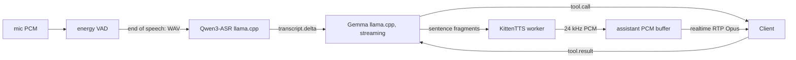

# Go Mode Local Voice Stack

The `local-stack` backend serves the unchanged
[voice gateway contract](VOICE_GATEWAY.md) with local ASR, LLM, and TTS. It is
half-duplex and needs no API key. It runs on macOS or Linux; macOS is the first
target. Target-Mac validation is phase `local-voice-quality` of
[PLAN_GOMODE.md](PLAN_GOMODE.md).

English-only speech models are acceptable for this stack. Multilingual support
is optional; language coverage alone must not rule out an ASR or TTS candidate.
Compare candidates on English quality, latency, memory use, and runtime
availability.

Noncommercial model licenses are acceptable for the owner's current usage.
Record each model's license in research comparisons; noncommercial terms alone
do not disqualify a candidate.

## Turn Flow



- ASR is final-only. After VAD end-of-speech, the adapter sends one in-memory
  WAV through `genai.Provider.GenSync` and emits one user transcript delta.
- Every LLM turn, including continuations after tool results, keeps tools
  available. `genai.Provider.GenStream` deltas go to TTS as stable sentence
  fragments. The final result drives history and tool calls.
- The fragmenter keeps text order, emits on stable punctuation or a size limit,
  and holds trailing text until the next boundary or the final flush.
- The selected TTS engine takes one request per fragment and streams PCM for
  each. Its 24 kHz mono S16LE output needs no resampling.
- Barge-in cancels the active turn and clears buffered assistant audio.
- `turn.status` reports `transcribing` at end of speech, `thinking` before
  generation, and `idle` when the turn ends. A turn superseded by newer speech
  reports nothing, so its late end cannot clear the newer turn's state.
- User utterances remain separate, in order. Dispatched tools belong to the
  session: interrupting generation or speech does not cancel a tool. Known late
  results are recorded once, in arrival order; unknown, duplicate and mismatched
  results report recoverable errors without advancing the conversation.
- Each user utterance or tool result starts generation with chronological
  history, even while other tools remain pending. Provider errors surface
  directly as a recoverable `error` shaped `<stage>: <cause>`, bounded to one
  line; the session stays usable and the gateway does not switch models or
  rewrite history. Server logs keep the unmodified error.
- The bridge drains assistant PCM at realtime from an unbounded buffer, so TTS
  can queue audio ahead of playback.
- Logs report TTS first audio per fragment, buffer depth, and first assistant
  RTP latency. Runtime readiness is logged separately; latency figures exclude
  setup.

Partial ASR waits for a protocol flag that marks transcript deltas provisional
or final, and for a runtime with useful partial results.

## Configuration

Use [`contrib/config.toml`](../contrib/config.toml) for configuration examples.
The configuration contracts and engine requirements live beside
[`ModelConfig`, `ChatConfig`, and `LocalStackConfig`](../voicegateway/config.go).
[`localstack_genai.go`](../voicegateway/voicertc/localstack_genai.go) owns adapter
startup, endpoint authentication, and speech runtime integration.

## Smoke Test

```sh
make test-smoke
```

The `smoke` build tag keeps these tests out of `make test` and CI;
`make verify` still lints them. Each test runs with its own `HOME` and XDG
directories, so it never reads or writes host configuration or caches, and
every run includes cold llama.cpp, uv, and KittenTTS setup. Only `HF_HOME`
stays on the host, defaulting to `~/.cache/huggingface`, so runs reuse
downloaded models. `TestSmokeVoiceRTCLocalAudio` checks TTS, ASR, LLM, managed
tool calls, and full WebRTC turns. `TestSmokeVoiceGatewayToolCall` serves the gateway HTTP API with
an explicitly configured local stack, speaks "Set a timer for five minutes." over WebRTC,
answers the `set_timer` tool call, and closes the session through the API.
Linux CPU runs prove wiring and audio-path correctness only; latency and
quality need the target Mac. Do not measure RSS.

## Further alternatives

### Single-model LFM3 audio with thinking

Select `LFM3 audio thinking (staged)` from the contributed configuration, or
add `staged = true` to an LFM3 `[[realtime]]` choice. The gateway manages one
llama.cpp model, or uses the choice's `remote` server. It sends each completed
English utterance as audio to chat generation, prefills `<think>` (or
`<think></think>` with `effort = "off"`), and supplies
the current tool schemas on every request, including tool-result continuations.
This combination of thinking and tool calling is experimental.

The final text answer is synthesized through the same model's `/tts` endpoint.
Generation completes before synthesis starts, so a single server slot is
sufficient. Native realtime and staged choices have distinct IDs and can be
selected independently. Residency limits still apply to both choices.

Thinking defaults to `effort = "medium"`. `max_output_tokens` defaults to zero,
leaving generation unlimited by the gateway and using the server default.
Reasoning is returned only
when the client requests it and is never spoken. Audio input is retained in
conversation history; this path does not produce user transcripts. Each utterance
is limited to 30 seconds and overlong input is reported as an error. Retained
audio is bounded to 8 MiB per session; reaching that limit requires a new session.
Voice selection is unsupported. This path waits for end of speech and adds a separate
synthesis stage; it does not have the native path's incremental audio prefill.

Evaluate these after measuring the target hardware:

- **ASR:** Parakeet through NeMo, `mudler/parakeet.cpp`, or ONNX. Gemma audio
  input is a fallback.
- **LLM:** MLX, or an OpenAI-compatible server such as vLLM or SGLang.
- **TTS:** Qwen3-TTS through Python or ONNX if its serving endpoint satisfies
  the gateway's PCM contract. Hosted DashScope Qwen TTS only validates the
  protocol.

## Open Decisions

- Target Mac model and RAM.
- Minimum Linux runtime profile.
- Whether Parakeet reaches acceptable latency on macOS without CUDA.
- Whether Android and the browser share one SKILL.md parser or test separate
  ones against the same golden files.
- Whether browser voice stays a product feature or becomes a debug path.
- How a host advertises and selects among gateway URLs, one per backend.
